# Tesseract [](https://github.com/surakin/tesseract/actions/workflows/test.yml)[](https://github.com/surakin/tesseract/actions/workflows/compile-check.yml)[](https://github.com/surakin/tesseract/actions/workflows/smoke.yml)


> The native desktop Matrix client you always wanted.

(If you don't know what Matrix is - not THE matrix, unfortunately, no one can be told what that is - go [here](https://matrix.org/) before reading forward)

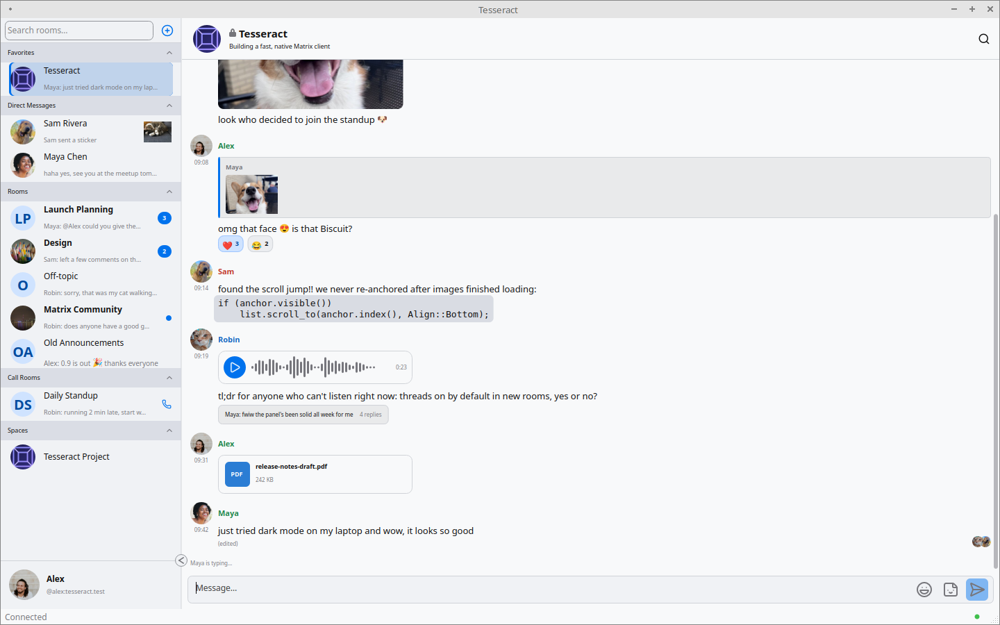

A full featured desktop multiplatform (Linux, Windows, Mac) Matrix client built on the [Matrix Rust SDK](https://github.com/matrix-org/matrix-rust-sdk)

> ⚠️ Tesseract only works with homeservers running **Sliding Sync** — login will fail if the server does not support it. The preferred login method is via the **Matrix Authentication Service (MAS)** / OAuth2; homeservers without MAS can fall back to plain username/password login for existing accounts. Legacy account registration is not supported.

---

## Installing

Grab whichever fits your system. Every release, with all the installers attached, lives on the [GitHub Releases page](https://github.com/surakin/tesseract/releases/latest); the [website](https://surakin.github.io/tesseract/) has the same links as buttons.

### Linux

**Flatpak** (updates through GNOME Software / KDE Discover once installed). Tesseract is served from its own repo rather than Flathub, but one command sets everything up, including the remote and the KDE runtime from Flathub:

```bash
flatpak install --user https://surakin.github.io/tesseract/io.github.surakin.Tesseract.flatpakref
flatpak run io.github.surakin.Tesseract
```

Drop `--user` to install system-wide. If you'd rather not add a remote, each release also has a single `.flatpak` file you can install with `flatpak install ./tesseract-vX.Y.Z.flatpak`, though that one won't auto-update.

**Other options:**

- **Arch Linux** — [`tesseract-matrix`](https://aur.archlinux.org/packages/tesseract-matrix) on the AUR for releases, or [`tesseract-matrix-git`](https://aur.archlinux.org/packages/tesseract-matrix-git) to always track the latest changes.
- **Debian / Ubuntu** — `.deb` from the Releases page.
- **Fedora / RHEL** — `.rpm` from the Releases page.
- **AppImage** — portable, also on the Releases page. `chmod +x` it and run.

### Windows

- [Microsoft Store](https://apps.microsoft.com/detail/9nz8v8tcnvjw), or
- the signed NSIS installer (`.exe`) from the Releases page.

### macOS

Download the `.dmg` for your CPU (Apple Silicon or Intel) from the Releases page and drag Tesseract into Applications.

The DMGs are Developer ID signed and notarized, and need macOS 13 (Ventura) or newer.

### Building from source

If you'd rather build it yourself (or there's no package for your distro), you need a C++20 compiler, CMake, Ninja, a Rust toolchain (via [rustup](https://rustup.rs)), and the UI toolkit's dev packages. [docs/BUILD.md](docs/BUILD.md) has the exact package lists per platform. Then, on Linux:

```bash
git clone https://github.com/surakin/tesseract
cd tesseract
cmake --preset linux-release
cmake --build build/linux-release

./build/linux-release/ui/linux-qt/tesseract    # Qt6 UI
./build/linux-release/ui/linux-gtk/tesseract   # GTK4 UI
```

Qt6 is the main Linux UI and the one that gets the most development and testing. The GTK4 port is kept working but is not the primary target, so expect the odd rough edge there.

The preset builds both UIs; if you only have one toolkit installed, pass `-DTESSERACT_UI=` to pick (see BUILD.md). The first build compiles the whole Matrix SDK, so expect it to take a while. Other platforms use their own presets, also listed in BUILD.md.

Planning to hack on Tesseract rather than just run it? Use `linux-debug` instead (same commands, `build/linux-debug` output) and see [Contributing](#contributing).

---

## Why Tesseract?

- **Truly native client on four platforms: Linux (Qt6 & GTK4), Windows and macOS.**
- **Multi account support**
- **All the fun details and functionality of popular chat apps.**

## Discussion room

Come join us in [#tesseract-client:matrix.org](https://matrix.to/#/#tesseract-client:matrix.org)!

---

## Screenshots

| Linux (Qt6) | Linux (Gtk4) | Windows | macOS |
|---|---|---|---|
|  | 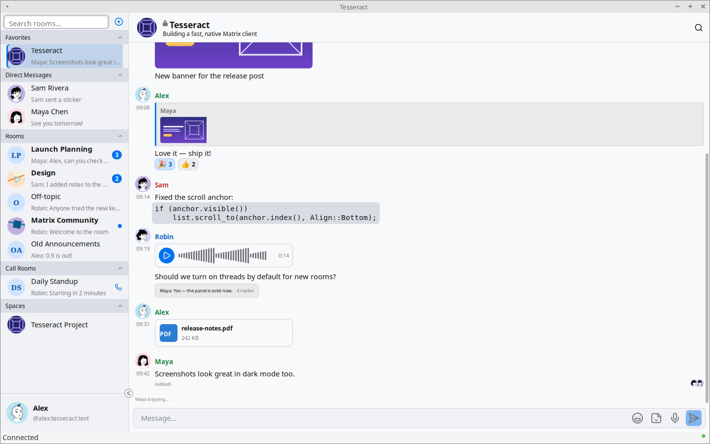 | 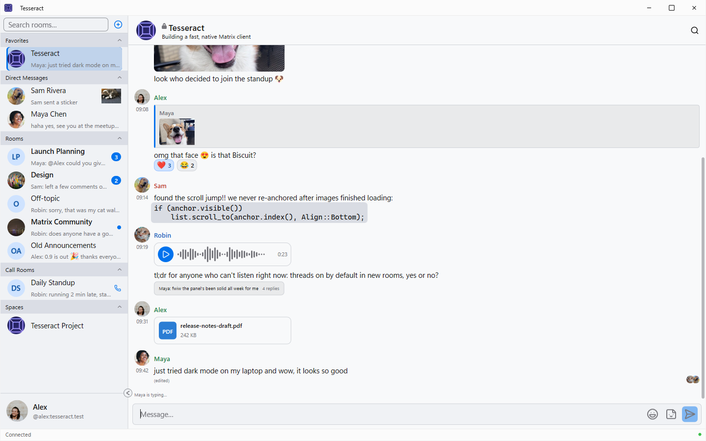 | 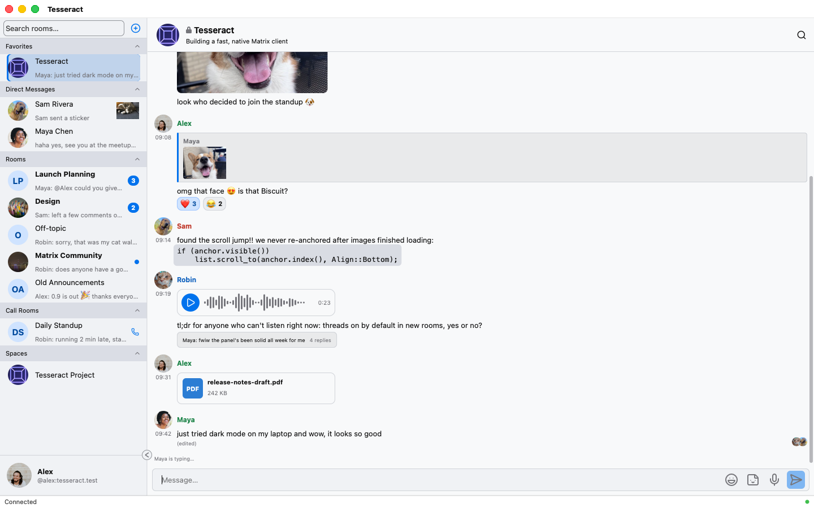 |
| 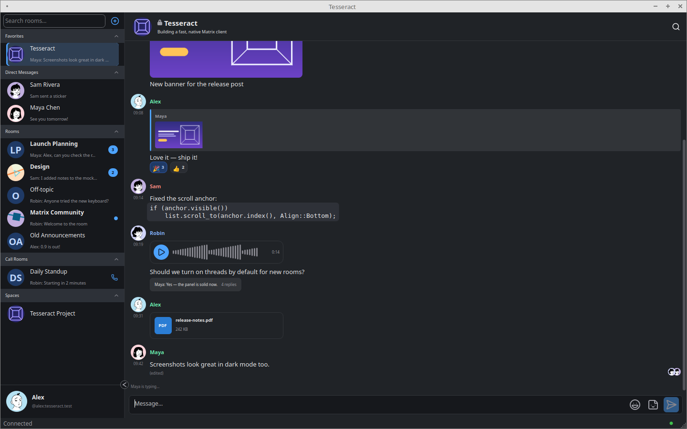 | 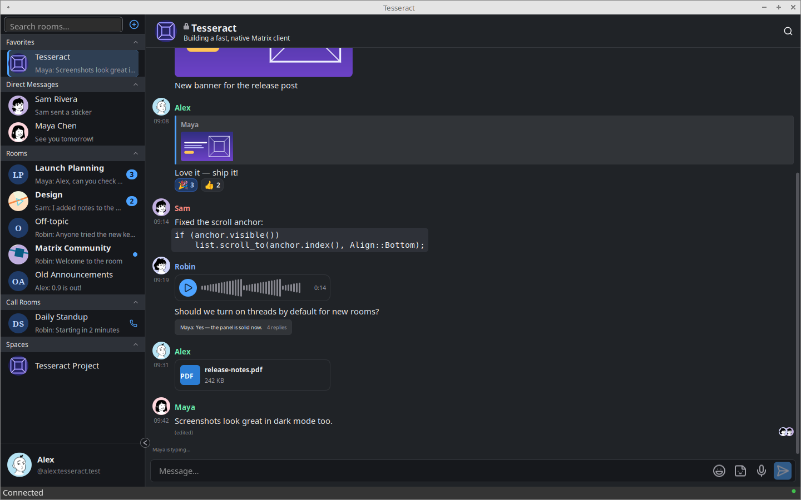 | 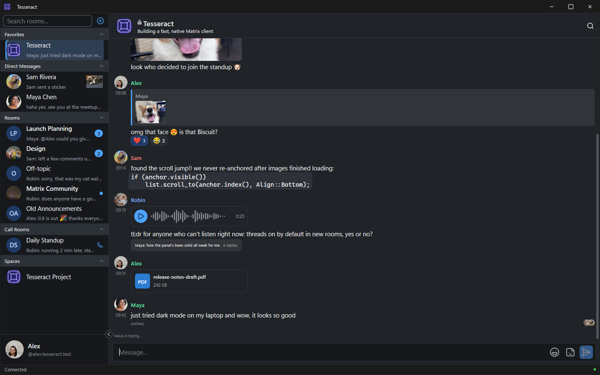 | 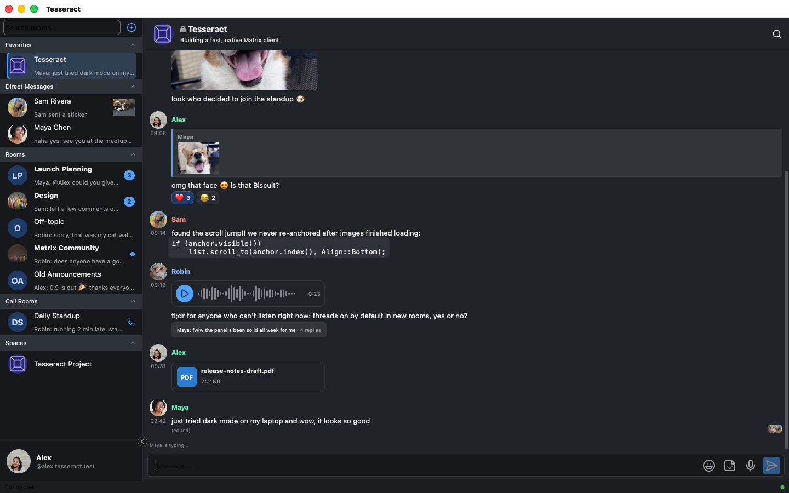 |

### Feature tour

| | |
|---|---|
| 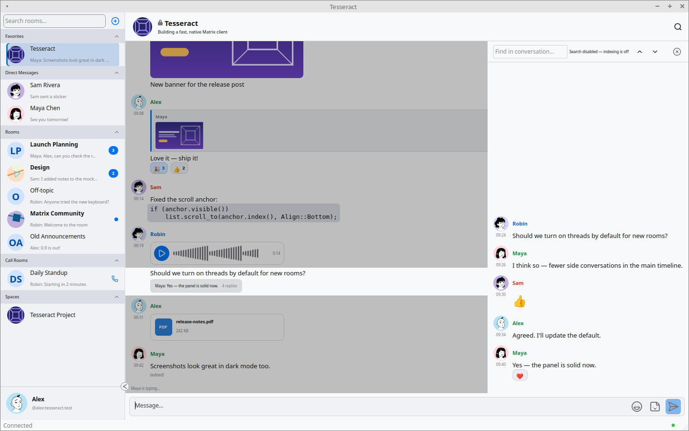 | 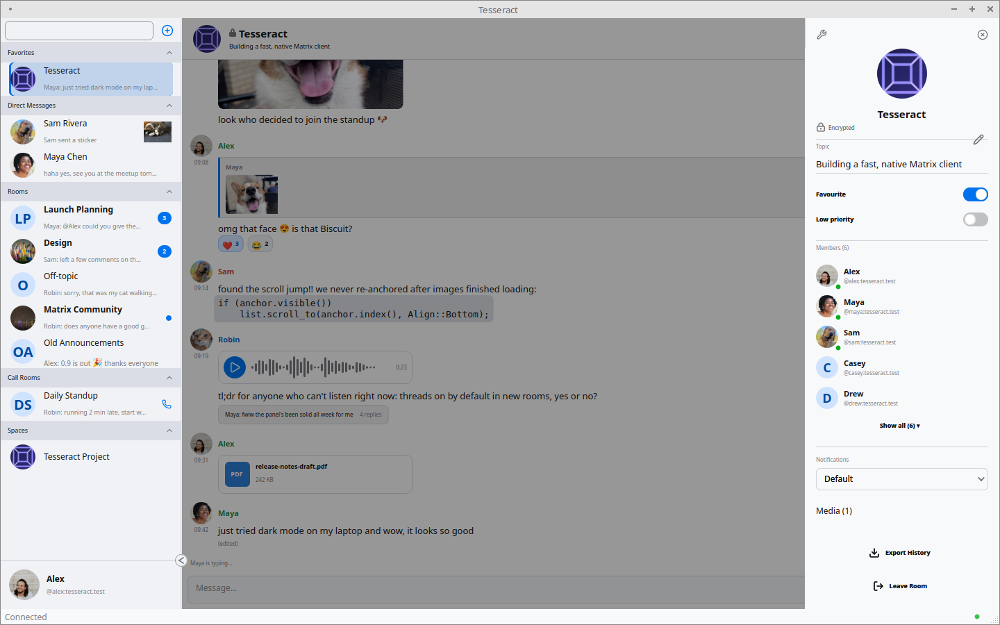 |
| **Threads** — reply in a side panel without leaving the conversation | **Room info** — members, roles and presence at a glance |
| 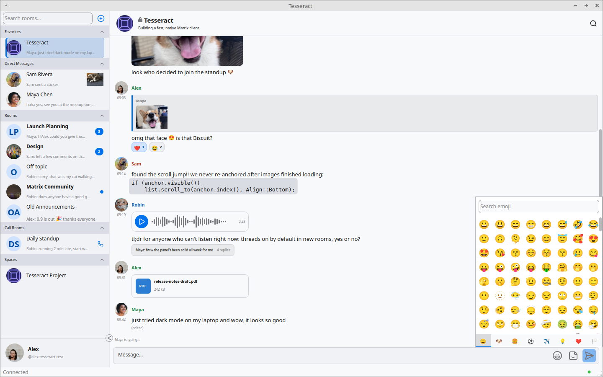 | 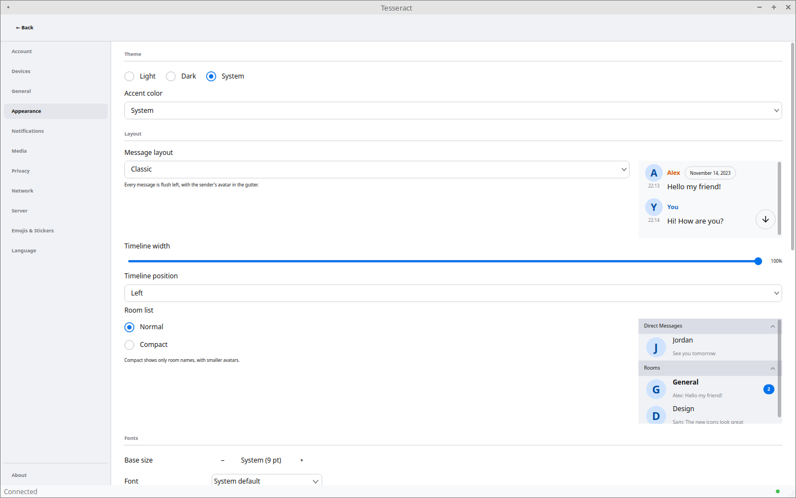 |
| **Emoji picker** — search, categories and skin tones | **Settings** — themes, accent colours and message layouts |


## Features

### Messaging

- Send, receive, edit, reply, react, and redact
- Markdown formatting (send and receive), with syntax-highlighted code blocks
- Custom emoji and reactions (image packs, MSC2545)
- Threads, with search, follow / unfollow (MSC4306), and an unread-thread indicator that survives restarts
- Pinned messages (pin / unpin, with power-level checks)
- Choice of message layout: Classic, Bubbles, or IRC (mIRC-style, monospaced with per-person coloring)
- Mentions with `@` autocomplete and rich pills; `:emoji:` shortcode autocomplete
- Read receipts (public and private), with per-reader timestamps and an overflow list; typing indicators, fully-read markers
- Day separators and new-message markers
- Automatic decryption retry as keys arrive — no permanent "unable to decrypt" placeholders
- MatrixRTC calls, including screen sharing!
- Per-room compose drafts (text, staged attachment, and caret position) persist across room switches

### Media

- Images, video, voice messages, audio, and files — send and receive
- Progressive video streaming (starts playing while still downloading)
- GIF search and send via `/gif` (animated preview strip in the picker; works in encrypted rooms)
- Animated GIF / WebP / APNG in the timeline
- JPEG XL images and animations
- Animated stickers, including bridged stickers
- Media captions
- Send images and files by clipboard paste or drag-and-drop
- Thumbnail-first loading, with an optional automatic full-media fetch
- Zoomable / pannable image viewer, with a full-screen mode for images and video
- Inline audio player with voice-message waveforms
- Download any file, image, or video
- URL previews

### Rooms & navigation

- Room list with Favorites, DMs, Rooms, and Spaces (tag-aware)
- Resizable, collapsible room-list sidebar (drag to resize, down to an icon-only mode with hover flyout)
- Sticky, collapsible section headers
- Space and subspace navigation, with unjoined child rooms shown as a preview panel
- Open multiple rooms in tabs and/or separate windows
- Back / forward room history (Alt+Left / Alt+Right; ⌘[ / ⌘] on macOS)
- Automatic grouping of inactive rooms (configurable)
- Jump-to-date with a calendar picker (if supported by server); it stops at the room's newest message
- Upgraded rooms keep their history reachable: a "View older messages" button in the new room, and a "replaced" strip in the old one
- Unread indicators and last-message previews (including media)
- Auto-scroll to the most-recent unread room when new messages arrive (optional)
- Direct messages
- Ctrl+K quick switcher with recently-visited strip
- Ctrl+Tab / Ctrl+Shift+Tab MRU room switcher (Alt-Tab-style: hold Ctrl, tap Tab to cycle recently-visited rooms, release to jump; Escape cancels); recent rooms are remembered per account across restarts
- Full-text message search across all rooms, including encrypted rooms (Ctrl+Shift+F / ⌘⇧F) — opt-in local index
- Room search (filter by name), and a room browser with a searchable, remembered server picker
- Slash commands (/me, /shrug, /slap, /spoiler, /myroomnick, /myroomavatar, /join, /leave, /invite, /gif, /selfie, /location, /poll)
- Room tags (favorite, low priority)
- Room creation (name, topic, alias, public/private)
- Room knocking: request to join a knock-restricted room, with admin/moderator review (accept / deny / deny-and-ban)
- Invite people from the room info panel
- Member moderation: kick and ban from the member list (with an optional reason), and a banned-users list with unban in room settings
- Room settings: name, topic, avatar, join rule, guest access, history visibility, encryption, and power-level thresholds (permissions)
- Full room-history export to plain text or HTML, optionally with images
- Optional room join/leave event display in the timeline

### Security & privacy

- End-to-end encryption with SAS verification of your own devices and of other users (numbers, plus emoji when the other side offers them)
- Key storage recovery and message-key export / import
- Initial encryption setup for new accounts
- OS-native secure credential storage on every platform
- Privacy controls, including presence send/poll toggles
- Device management
- MSC4278 media preview controls
- Digital identity reset
- Clear-cache action (leaves the crypto/session store intact)
- Optional local crash handler (opt-in, off by default): writes a stack trace to disk only, nothing is transmitted anywhere

### Notifications

- Native desktop notifications with inline media
- Unified Push on Linux
- Per-room notification settings (mute / mentions / all)
- Respects your server-side push rules

### Platform integration

- System tray with unread/mention indicator (clicking the icon jumps to the first unread room), and a choice of what closing the window does — quit, hide to the tray or minimize — with an opt-in "start minimized to tray"
- Multi-account, with profile editing (display name, avatar, pronouns, timezone, and biography — MSC4133; plus a status emoji + text — MSC4426)
- QR-code login (MSC4108; shown only when the server supports it)
- Single-instance behavior (relaunching restores the running window)
- Session restore (all open room tabs and the active account)
- Automatic update checker (opt-in; Settings → Privacy)
- In-flight request indicator in the status bar
- Low power mode (Auto / On / Off) — pauses background work (backfill, prefetch, cache GC, search indexing) while keeping sync live
- Light / dark / system themes
- Translated into German, Spanish, French, Norwegian Bokmål and Ukrainian; pick the language under Settings → General → Language (Auto follows the OS)
- Server info (software, spec range, supported features, what you may change) under Settings → About
- Configurable fonts (base size, UI and monospace families, per-category overrides) and a compact room list, under Settings → Appearance
- Open images, videos and files in the system's default viewer (opt-in, Settings → Media & Calls)
- Photos are stripped of EXIF/GPS and other metadata on upload, whether sent as an image, a file or in a gallery
- HTTP proxy: system (default), none or manual, under Settings → General → Network (reachable from the login screen before signing in)
- Animated avatars (GIF, animated WebP, APNG), switchable under Appearance → Timeline
- Windows: installable via the Microsoft Store or an NSIS installer; taskbar unread/mention overlays, thumbnail controls, and Jump Lists
- Linux: system-wide room/contact search via GNOME Shell search and KRunner; MPRIS media controls for voice/audio playback; installable via a self-hosted Flatpak repo (not Flathub — see [packaging/flatpak/README.md](packaging/flatpak/README.md)), plus DEB/RPM/AppImage/AUR
- macOS: Now Playing integration for voice/audio playback; rooms and contacts indexed for Spotlight search; every keyboard-shortcut action (Settings, Add Room, Find, Search Your Messages, Go Back/Forward, Quick Switcher, Room Info, Cycle Recent Rooms, Keyboard Shortcuts) has an application menu-bar entry

## Quick usage reference

New to Tesseract or Matrix? Read the [user guide](docs/USER-GUIDE.md). The essentials:

- Ctrl+/ (⌘/ on macOS) or F1 = list every keyboard shortcut (also in the user menu; Help menu on macOS)
- Ctrl+click on room = open room in a tab
- Ctrl+click on a room tab = open room in a separate window
- Right click on the user info (bottom left) to add an account or open settings
- Left click on the user info to open account picker (only if there is more than one account)
- Ctrl+click on an account in the account picker to open said account in a separate window.
- Command-line options (`--help`, `--profile`, `--hidden`, `--open-room`, `--logoutall`, …) are listed in [docs/CLI.md](docs/CLI.md).

## Server requirements

- **Sliding Sync** — the room list and timelines are driven entirely by Sliding Sync (native, e.g. Synapse's built-in support). Servers without it won't sync rooms at all.
- **Login** — Tesseract logs in via OAuth 2.0 / OIDC against **Matrix Authentication Service (MAS)**. See [Matrix Authentication Service](https://element-hq.github.io/matrix-authentication-service/) for how to add MAS to a Synapse deployment. Homeservers without MAS can instead use a legacy username/password (`m.login.password`) login for already existing accounts.

## Supported MSCs & spec compatibility

The Matrix Spec Change proposals Tesseract implements are listed in
[docs/MSCS.md](docs/MSCS.md).

## Minimum OS requirements

| Platform | Minimum OS | Architecture |
| -------- | ---------- | ------------ |
| Windows (Win32) | Windows 10 version 1607 (Anniversary Update) | x86-64 |
| macOS (AppKit) | macOS 13 Ventura | Apple Silicon (arm64) or Intel (x86-64) |
| Linux — Qt6 | Debian 12 (Bookworm) / Ubuntu 24.04 LTS or newer | x86-64 |
| Linux — GTK4 | Debian 13 (Trixie) / Ubuntu 24.04 LTS or newer (GTK ≥ 4.12) | x86-64 |

---

## A note on how this was built

I've been a developer for more than 20 years, ran my own homeserver for more than 8, and developed a few things here and there in the matrix ecosystem (hello, encrypted sticker support on Element X!). I am also a bit tired of everything being a bloated web app (with all the respect to the element web guys), so I decided it was time to do something about it. I mean, seriously. Does EVERYTHING need to be a browser?

This started as a Claude Code experiment, because eventually I gave up and decided to learn what all this fuss was about, at least to be less worried about being out of a job, if that ever happens. So I thought: what was the app I always wanted to do my way and never had the time and/or energy? Yes! A Matrix client, of course.

So I paid for a month of Claude Max and set myself to see if I could create a full blown Matrix client in that time. Apparently, it can be done, but I don't recommend it; it can be quite time consuming anyway.

It's important to point out that EVERYTHING related to the matrix protocol and communication with the homeserver goes through the matrix-rust-sdk. I didn't set to reimplement the protocol, or encryption, or any of the most sensitive parts of a matrix client, because that would be stupid, and we have this awesome piece of code already written by humans way smarter than any LLM.

I used Claude to write everything else: a C++/Rust bridge to be able to use the SDK from a shared toolkit library and the four platform-specific thin shells.

If you don't like or trust AI-assisted developed apps, that's fine. I'm not sure I do, but this one I made, reviewed the code, and I'm kinda sure what it's doing inside.

Bottom line, I made this little client, and I barely open element these days, which was sort of the point. The code is open, you can see everything, and any positive contribution/criticism is welcome.

---

## Project status

The app is mostly complete and can be used for existing accounts and new accounts. I'm curious to see if there is any interest for it out there. I expect to keep polishing it and updating it as the matrix spec evolves. But I do have a day job, and it's not this one :) So I can't promise things are going to be fixed immediately.

There are a few things missing here and there, but I plan to add them as soon as I can.

Also I don't speak as many languages as I would like to, so translations (German, Spanish, French, Norwegian Bokmål and Ukrainian so far) are a bit lagging behind. I'll do something about that, when I learn how. Stay tuned.

Disclaimer: I have the same design talents as a brick, so even if I made my best effort to make it look good, I'm sure there is a lot of room for improvement.

---

## Contributing

See [CONTRIBUTING.md](CONTRIBUTING.md) to get started, and the [documentation index](docs/README.md) and [developer guide](docs/DEVELOPING.md) for how the code is organised. I'm open to any kind of contribution, with only one caveat: UI parity. I did my best for the app to look more or less the same in all the platforms and I want to keep that.

If you don't care about UI parity or are interested in only one platform, you're welcome to fork it and make it yours! That's the beauty of open source, isn't it?

---

## Acknowledgements

First of all, big kudos to the Matrix.org foundation and all their awesome people! And Anthropic, for Claude. It's been interesting, to say the least.

Tesseract stands on the work of many open-source projects.

The screenshot fixture's user avatars are generated from [Lorelei](https://www.figma.com/community/file/1198749693280469639) by Lisa Wischofsky, and its room avatars use [DiceBear Shapes](https://www.dicebear.com/styles/shapes/). Both avatar sets are available under [CC0 1.0](https://creativecommons.org/publicdomain/zero/1.0/).

| Library | Purpose | Author / Maintainer |
| --- | --- | --- |
| [matrix-rust-sdk](https://github.com/matrix-org/matrix-rust-sdk) (`-base`, `-ui`) | Matrix client, sync, E2E encryption, timeline | The Matrix.org Foundation / Element |
| [ruma](https://github.com/ruma/ruma) | Matrix data types & event (de)serialization | The Ruma project |
| [cxx](https://github.com/dtolnay/cxx) | Safe Rust ↔ C++ FFI bridge | David Tolnay |
| [tokio](https://github.com/tokio-rs/tokio) | Async runtime | Tokio project (Carl Lerche et al.) |
| [reqwest](https://github.com/seanmonstar/reqwest) | HTTP client (rustls-TLS) | Sean McArthur |
| [serde](https://github.com/serde-rs/serde) / serde_json | Serialization framework | David Tolnay & Erick Tryzelaar |
| [futures-rs](https://github.com/rust-lang/futures-rs) | Async combinators | The Rust `futures-rs` team |
| [anyhow](https://github.com/dtolnay/anyhow) | Error handling | David Tolnay |
| [tracing](https://github.com/tokio-rs/tracing) | Structured logging | Tokio project |
| [url](https://github.com/servo/rust-url) | URL parsing | The Servo project |
| [rusqlite](https://github.com/rusqlite/rusqlite) | SQLite bindings | The rusqlite project |
| [syntect](https://github.com/trishume/syntect) | Code-block syntax highlighting | Tristan Hume |
| [audiopus](https://github.com/lakelezz/audiopus) | Opus codec bindings (voice) | Lars Wirth |
| [ogg](https://github.com/RustAudio/ogg) | Ogg container parsing (voice) | RustAudio |
| [mime](https://github.com/hyperium/mime) | MIME types | Sean McArthur |
| [Qt6](https://www.qt.io/) (Core, Gui, Widgets, Multimedia, DBus, Concurrent, Network) | Linux (Qt6 shell) | The Qt Company / Qt Project |
| [GTK4](https://www.gtk.org/) + Pango / Cairo / gdk-pixbuf | Linux (GTK shell) | The GNOME Project |
| [GStreamer](https://gstreamer.freedesktop.org/) (+ gst-plugins-base for Opus) | Linux video and animated-image decode, camera/screen capture, call video, GTK voice playback | The GStreamer Project |
| Win32 / Direct2D | Windows | Microsoft |
| [BetterText](https://github.com/surakin/bettertext) (vendored) | Windows compose text control (D2D/DirectWrite) | surakin |
| AppKit / CoreGraphics / CoreText | macOS | Apple |
| [libwebp](https://github.com/webmproject/libwebp) via [libwebp-sys](https://crates.io/crates/libwebp-sys) / [webp](https://crates.io/crates/webp) (BSD-3-Clause) | Animated WebP avatar encode; macOS animated WebP sticker decode | Google / The WebP project |
| [jxl-oxide](https://crates.io/crates/jxl-oxide) (MIT OR Apache-2.0) | JPEG XL image and animation decode | Tirr |
| [nanosvg](https://github.com/memononen/nanosvg) (vendored) | SVG icon rasterization | Mikko Mononen (incl. AntiGrain code by Maxim Shemanarev) |
| [Lucide](https://lucide.dev/) (ISC) | UI icon set | The Lucide Contributors (community fork of Feather) |
| [nlohmann/json](https://github.com/nlohmann/json) | C++ JSON parsing | Niels Lohmann |
| [Catch2](https://github.com/catchorg/Catch2) | C++ unit test framework | Martin Hořeňovský et al. |
| [Corrosion](https://github.com/corrosion-rs/corrosion) | CMake ↔ Cargo bridge | The Corrosion project |
| [CMake](https://cmake.org/) | Build system | Kitware |
| [Ninja](https://github.com/ninja-build/ninja) | Build backend | Evan Martin / Google |

---

## License

Tesseract is licensed under the [GNU General Public License v3](./LICENSE),
with an [additional permission](./LICENSE-EXCEPTION.md) (GPLv3 section 7) for
distribution through the Apple App Store.

---

### Notes

- **Windows** — the build targets `_WIN32_WINNT=0x0A00`. `GetDpiForWindow`
  and per-monitor-v2 DPI awareness require Windows 10 1607; Windows 11 is
  also supported. The rendering stack is Direct2D + DirectWrite + WIC and
  audio uses Media Foundation, all present from Windows 10.
- **macOS** — deployment target and `LSMinimumSystemVersion` are both 13.0.
  Builds are per-architecture (arm64 or x86-64). Voice-message (MSC3245
  opus) playback additionally requires **macOS 14+**; the rest of the app
  runs on macOS 13+.
- **Linux (Qt6)** — runtime depends on Qt ≥ 6.4, which is the version
  shipped by Debian 12 and Ubuntu 24.04 LTS. Older distros work if a
  Qt ≥ 6.4 is provided.
- **Linux (GTK4)** — needs GTK ≥ 4.12 (`GtkFileDialog`,
  `gtk_css_provider_load_from_string`), available from Debian 13 / Ubuntu
  24.04 onward, plus GStreamer base/good plugins (for voice-message
  playback); the system tray is a built-in StatusNotifierItem D-Bus
  implementation and needs no AppIndicator package.
- **Building from source** requires Rust ≥ 1.96 (the pinned matrix-sdk's
  minimum) on every platform (install via `rustup` on distros that ship an
  older toolchain). See
  [docs/BUILD.md](docs/BUILD.md) for build setup and
  [PACKAGING.md](PACKAGING.md) for building installers.
