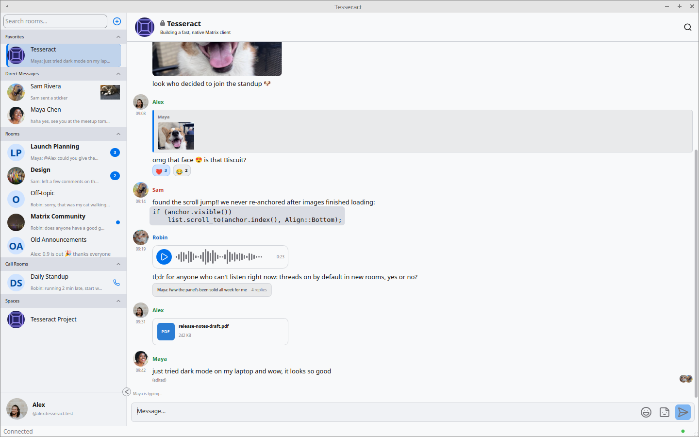

# Tesseract user guide



Tesseract is a chat app for the Matrix network. It runs natively on Linux, Windows and macOS, so it starts fast and uses far less memory than a browser-based client. If you have used Element, Discord or Slack, most of it will feel familiar.

This guide covers the ideas you need and the things that are not obvious. Everything else you can find by clicking around.

## 1. What Matrix is, in one minute

Matrix is like email for chat. You have an account on a **homeserver** (yours, your company's, or a public one such as matrix.org). Your address looks like `@alice:example.org`. People on other servers can talk to you, and no single company owns the network.

Tesseract is only the window you look through. Your messages live on your homeserver.

**Your server must support Sliding Sync.** Recent Synapse versions do. If you can't sign in, ask your server admin.

## 2. Signing in

1. Start Tesseract and type your Matrix ID (`@alice:example.org`) or just your server's name (`example.org`). If you don't have a server, the **Find a server** button lists public ones.
2. Click **Sign in**. Tesseract opens your browser so you can sign in on your server's own page. Tesseract never sees your password.
3. If your server accepts passwords, a **Sign in with password** button appears too, sometimes next to browser sign-in.

If your server allows registration, a **New here? Create an account** link appears. Servers that only support the old registration method can't create accounts from Tesseract. Register on their website, then sign in here.

Behind a proxy? The wrench button on the login screen opens the network settings (also in Settings → General → Network).

## 3. The window

- **Left: the room list.** It is grouped into sections such as Invitations, Unread, Favorites, Direct Messages, Rooms and Spaces. Drag its edge to resize it, or shrink it to an icons-only strip.
- **Middle: the conversation.** Messages are at the top, and the box where you type is at the bottom.
- **Bottom left: you.** This is your avatar and name.
  - Left-click it to switch accounts (only shown if you have more than one).
  - Right-click it to add an account or open Settings.

A **room** is a conversation, a **space** is a folder of rooms, and a **thread** is a side conversation attached to one message.

## 4. Everyday chatting

| To do this | Do this |
| --- | --- |
| Reply, reply in a thread, edit, react, forward, pin, delete, report | Right-click a message, or use the toolbar that appears when you hover over it |
| Mention someone | Type `@` and pick the name |
| Insert an emoji | Type `:smile:` (it suggests as you type), or use the emoji button |
| Format text | Use Markdown: `**bold**`, `_italic_`, `` `code` ``, lists, quotes |
| Start a new line | Shift+Enter (Enter sends) |
| Edit your last message | Press Up in an empty message box |
| Send a picture or file | Paste it (Ctrl+V), or drag it into the window |
| Send a voice message | Click the microphone button to start recording and click again to stop. The cancel button discards it |
| Send a GIF | Type `/gif cats` |

Other slash commands: `/me`, `/shrug`, `/spoiler`, `/join`, `/leave`, `/invite`, `/location`, `/poll`.

Photos lose their location and camera data (EXIF/GPS) before upload, so you don't leak where you took them.

Drafts are saved per room. If you switch rooms halfway through typing, your text is still there when you return.

### Message layout

Settings → Appearance lets you choose how messages look:

- **Classic:** a flat list.
- **Bubbles:** chat bubbles, like a phone messenger.
- **IRC:** compact, in a monospaced font, with a colour per person.

## 5. Getting around fast

- **Ctrl+K** (⌘K on Mac) is the quick switcher. Type part of a room name and press Enter.
- **Ctrl+Tab** cycles through the rooms you used recently, like Alt+Tab.
- **Alt+Left / Alt+Right** go back and forward through your room history (⌘[ and ⌘] on Mac).
- **Ctrl+Shift+F** searches your messages (see section 7).
- **Ctrl+/ or F1** shows every shortcut (⌘/ on Mac, which has no F1). This is the one to remember.
- **Ctrl+click a room** (⌘-click on Mac) opens it in a tab. **Ctrl+click a tab** moves it to its own window. This is handy if you want to keep a busy room visible.

## 6. Calls

Voice, video and screen-sharing calls work inside rooms (they use MatrixRTC, the same as Element Call). Click the call button in the room header and choose **Audio call** or **Video call**. Others in the room see a banner with a **Join** button, which opens a lobby with **Join call**. You need permission in that room to start or join calls. The call button is hidden in bridged rooms and on servers without call support.

## 7. Privacy and encryption

Most private rooms are **end-to-end encrypted**. Only the people in the room can read the messages, not even your server. The price is that you need your **keys**, which are the secrets that unlock your history.

**Save your recovery key.** Normally Tesseract turns on key storage and creates a **recovery key** for you when you sign in, without asking. The key is kept in your operating system's secure store, and a reminder at the top of the window asks you to save a copy.

- Click **Show me** on the reminder, then **Show my recovery key**, and **Copy** it or use **Save to file…**. Keep it somewhere safe, like a password manager.
- On an account that already existed, you see a **Key storage is now on** notice instead.
- Lose your device without a saved recovery key and you lose your old encrypted messages. No one, including the Tesseract developers, can get them back.
- On a new device, you unlock your history with the recovery key, or with a passphrase you chose earlier.
- If automatic setup is off or fails, or you turned key storage off, Tesseract offers to create a recovery key. There you can choose **Use a recovery passphrase instead**.

**Verify your devices.** When you sign in on a second device, verify it from the first. Tesseract shows a short list of emoji or numbers for both sides to compare. This stops anyone quietly adding a device to your account. You can do the same with another person to confirm you are really talking to them.

Settings → Privacy holds the online-status toggle and whether Tesseract may check for updates (only in some builds); link-preview options are in Settings → Messages, and message-key export and import are in Settings → Security & Devices. Your sign-in tokens and recovery key are stored in the operating system's own secure store (Keychain, Credential Manager or Secret Service). Tesseract never sees your password.

### Searching encrypted rooms

Servers can't search encrypted messages, because they can't read them. Tesseract can search them on your computer by building a private index of the decrypted text. It is off until you turn on **Index messages for search** in Settings → Messages → Search.

## 8. Several accounts

You can be signed in to several accounts at once, for example personal and work. The room list shows one account at a time. Switch with the account picker, or Ctrl+click an account (⌘-click on Mac) to open it in its own window. Other accounts show an unread badge.

For two completely separate copies of Tesseract with their own data, use **profiles** (section 12).

## 9. Notifications

- Desktop notifications appear with images inline.
- Each room can be set to notify for all messages or for mentions only. Look in the room's info panel (Ctrl+I).
- The tray icon shows a dot when you have unread messages, and a different colour for mentions. Click it to jump to the first unread room (rooms with mentions first, then the most recent).
- Closing the window can quit the app, hide it to the tray, or minimise it. You choose in Settings → General.
- On Linux, Tesseract can receive push notifications through UnifiedPush while it is running, for example hidden in the tray.

## 10. Settings

Settings is a list of pages, in this order:

| Page | What's in it |
| --- | --- |
| Account | Your name, avatar, pronouns, time zone, bio, status |
| Devices | Your signed-in devices; sign out ones you don't recognise |
| General | Start at login, start in the tray, what closing the window does, low power mode (only on machines with a battery) |
| Appearance | Light/dark theme, accent colour, message layout, fonts, compact room list |
| Notifications | Turn desktop notifications on or off, hide message content, and choose what notifies you (mentions, @room, keywords) |
| Media | Media previews, pre-loading images, opening files in other apps, microphone and speaker choice |
| Privacy | Online status, link previews, encrypted-message search, update checks (some builds only), message-key export and import, digital identity reset |
| Network | Proxy |
| Server | What your homeserver supports and what you may change |
| Emojis & Stickers | Custom emoji and sticker packs |
| Language | Interface language |
| About | Version info and **Clear all caches**. The **Advanced** button at the bottom reveals the Advanced page |
| Advanced | Developer options and the Activity Monitor. It stays hidden until you click **Advanced** on the About page, and hides again when you leave it |

**Clear all caches** (About) throws away downloaded data and rebuilds it. It closes any open tabs and pop-out windows, but keeps your login and your encryption keys. Use it if something looks stale or broken.

**Low power mode** pauses background work, such as downloading old history and previews, while still delivering new messages. The default is Auto: it turns on when you are on battery or your system's energy saver is on.

## 11. Other things worth knowing

- **Pinned messages:** pin a message from its menu (if your role allows). Pinned messages show in a banner at the top of the room.
- **Threads:** "Reply in thread" opens a side panel, so a long discussion doesn't bury the main conversation.
- **Spaces:** a space groups rooms, like a server folder. Join the space and its rooms appear under it. Rooms you haven't joined yet show a preview.
- **Room info and settings:** Ctrl+I shows the room's members and details. Its room settings button opens: General, Media (not for spaces), Security & Privacy, Permissions, Moderation, Emojis & Stickers and Bridge (only for bridged rooms).
- **Bridges:** a bridged room is connected to another chat network (Discord, Telegram and so on). A badge marks it, and Tesseract adjusts a few features (for example forwards) so the other network isn't confused. If a room is flagged wrongly, use Room settings → Bridge to say it isn't bridged.
- **Custom emoji and stickers:** Settings → Emojis & Stickers holds your own sticker pack and the packs you've subscribed to. You can save a sticker from a message with **Add to Saved Stickers**.
- **Export a room's history:** Room info → Export History saves a room as plain text or HTML, optionally with images. If an export is interrupted, you're offered to resume it.
- **Moderation:** with the right role you can kick and ban from the member list, with an optional reason. Banned users are listed in Room settings → Moderation.

## 12. For power users: the command line

Tesseract takes a few options. On Windows and macOS the program is called Tesseract. On Linux, installed packages call it `tesseract-matrix` (Qt) or `tesseract-matrix-gtk` (GTK), because `tesseract` is the name of an OCR tool on most distributions. The examples use the Qt name:

```bash
tesseract-matrix --profile=work     # a completely separate copy: own accounts, own settings
tesseract-matrix --hidden           # start in the tray
tesseract-matrix --open-room '!id:server'
```

The full list is in [CLI.md](CLI.md).

## 13. When something goes wrong

| Symptom | What to try |
| --- | --- |
| Can't sign in, or no rooms appear | Your server probably lacks Sliding Sync. Ask the admin |
| "Unable to decrypt" on a message | Wait a moment. Tesseract retries on its own as keys arrive, either from your server's encrypted key backup or from your other devices. If it persists, make sure you have entered your recovery key (section 7) |
| Old messages are locked on a new device | Enter your recovery key (section 7) |
| Things look stale or stuck | Settings → General → Storage → Clear all caches |
| Lost both the recovery key and every device | The old encrypted history can't be recovered. In the unlock dialog choose **I've lost my recovery key and other devices** to start over with a new key. People you chat with will see that your digital identity changed |

Still stuck? Join the community room at [#tesseract-client:matrix.org](https://matrix.to/#/#tesseract-client:matrix.org), or open an issue on GitHub.

## Where to go next

- [README](../README.md): installing, supported platforms, feature list
- [CLI.md](CLI.md): every command-line option
- [MSCS.md](MSCS.md): which Matrix proposals are supported
- [ARCHITECTURE.md](ARCHITECTURE.md): how it is built (for developers)
